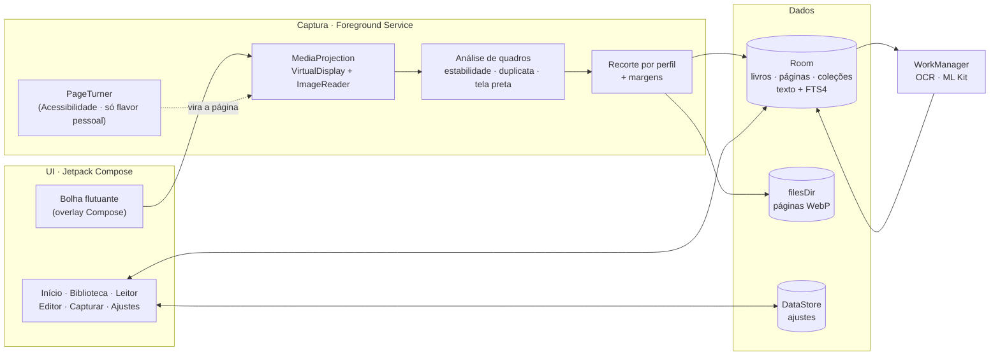

<div align="center">

# print-book

**Sua leitura não para quando a internet acaba.**

Organizador pessoal de leitura offline para Android: capture as páginas que você já tem acesso no seu app de leitura, leia em qualquer lugar e apague quando voltar.


-3DDC84?logo=android&logoColor=white)


</div>

---

## O problema

Quem lê por assinatura conhece a cena: férias num lugar sem sinal, uma viagem longa, um voo, e o livro que você paga para ler simplesmente não abre. Muitos apps de leitura exigem conexão para abrir o leitor ou não oferecem leitura offline completa. O resultado é tempo de leitura perdido justamente quando sobra tempo para ler.

## A solução

O **print-book** é um organizador pessoal. Enquanto você ainda tem acesso ao conteúdo, ele captura as páginas que o seu app de leitura mostra na tela e monta um "print-book": um livro de imagens, com cara de app de leitura de verdade, que funciona sem internet. Quando você volta, pode apagar tudo e continuar lendo normalmente no app original.

> **Uso responsável:** o print-book só captura o que já está visível na sua tela, de conteúdo ao qual você tem acesso legítimo. Ele **nunca** contorna proteções: se um app bloqueia captura de tela (`FLAG_SECURE`), o print-book detecta a tela preta, avisa e para. As páginas ficam só no aparelho: fora da galeria e fora do backup, sem envio para servidor nenhum.

---

## Funcionalidades

### Captura
- **Botão flutuante** sobre o app de leitura (overlay arrastável, construído em Compose), que some no instante da captura e não aparece nas imagens.
- **Três modos:**
  - **Manual:** um toque por página.
  - **Semiautomático:** você vira a página e o app captura sozinho quando a tela para de mudar.
  - **Automático:** o app vira as páginas e para sozinho no fim do livro. Disponível só na versão de uso pessoal; veja [Variantes](#variantes-de-build).
- **Recorte inteligente** por perfil de app (barras do leitor, rodapés de progresso e margens uniformes).
- **Descarte de páginas repetidas** por assinatura de imagem, e detecção de **fim do livro**.
- **Aura de captura:** um gradiente animado contorna a tela logo depois que a página é salva. É desenhado *depois* do quadro capturado, então nunca entra na imagem.

### Leitura
- Leitor com **zoom** (pinça, duplo toque e botões +/−), virada por toque nas bordas e **teclas de volume**.
- **Filtros de cor:** original, noturno (invertido), sépia e escurecido.
- **Marcadores**, barra de progresso e **"continuar lendo"** onde parou.

### Biblioteca e texto
- Biblioteca em grade ou lista, com **favoritos**, **coleções**, ordenação e busca.
- **Busca no texto das páginas:** OCR offline (ML Kit embutido) e índice **FTS4** que ignora acentos ("aproximacao" encontra "aproximação"). O trecho encontrado aparece destacado.
- **Editor de páginas:** reordenar, girar, definir capa e excluir.
- **Exportar PDF** do print-book, para uso pessoal.

---

## Arquitetura



**Decisões principais**
- **Single-Activity** + Navigation Compose com rotas tipadas, **MVVM** com `StateFlow`, **Hilt** para injeção e nenhum estado global estático.
- **Uma sessão de captura = um `VirtualDisplay`**, respeitando o consentimento por sessão do Android 14+. Uma autorização cobre o livro inteiro.
- **Análise de imagem em funções puras** (`FrameSignature`, `AutoCaptureTrigger`, `AutoTurnController`, `CropMath`, `BlackFrameDetector`), testáveis na JVM sem Android.
- **Arquivos com nome independente da posição:** reordenar páginas só mexe no banco.
- **Resiliência na One UI:** a espera para esconder a bolha não depende do `Choreographer`, que a Samsung pausa com o app em segundo plano. Esse bug foi encontrado e corrigido em teste real.

Detalhes em [`docs/SYSTEM_DESIGN.md`](docs/SYSTEM_DESIGN.md).

---

## Stack

| Área | Tecnologias |
|---|---|
| Linguagem e UI | Kotlin 2.4, Jetpack Compose, Material 3, Navigation Compose (rotas tipadas) |
| Arquitetura | MVVM, Hilt, Coroutines/Flow |
| Dados | Room (com AutoMigration e FTS4), DataStore, armazenamento privado em `filesDir` |
| Captura | MediaProjection, VirtualDisplay, ImageReader, Foreground Service, `TYPE_APPLICATION_OVERLAY`, AccessibilityService (gestos) |
| Imagem e texto | WebP lossless/lossy, ML Kit Text Recognition (offline), assinaturas de quadro próprias |
| Leitor | Telephoto (zoom e subsampling), Coil 3 |
| Background | WorkManager + `@HiltWorker` |
| Design | Tokens próprios (claro/escuro), Geist + Geist Mono, iconografia própria, adaptive + themed icon |
| Testes | JUnit, Truth, Turbine, coroutines-test |

---

## Resultados medidos em aparelho real

Testes num Galaxy A56 com Android 17, registrados em [`docs/medicoes-fase1.md`](docs/medicoes-fase1.md):

| Teste | Resultado |
|---|---|
| Captura automática, 100 páginas | **100/100 em 5 min 47 s**, 0 repetidas, parada automática no limite |
| Captura semiautomática, 2 × 100 páginas | **200/200**, nenhuma página perdida ou duplicada |
| Fim do livro | Detectado sozinho, sem salvar a tela que vem depois da última página |
| OCR offline | **482/482 páginas indexadas, 0 falhas**, ~1,5 s por página em segundo plano |
| Qualidade "Econômica" | **−46% de espaço** contra WebP lossless, com o texto ainda nítido |
| Aura e bolha | Ausentes em todas as páginas verificadas |

---

## Design

Identidade **"Ink & Terminal + Aura"**: papel quente, tinta escura e um único acento cobre, com toques de desenvolvedor nos detalhes (metadados em fonte monoespaçada, status em linha de terminal) e conforto de leitura em primeiro lugar. Os protótipos navegáveis estão em [`docs/design/`](docs/design/).

---

## Variantes de build

| Variante | Para quê | Diferença |
|---|---|---|
| `pessoal` | Uso pessoal (sideload) | Inclui a virada automática por Acessibilidade e a exportação em PDF |
| `loja` | Base para uma futura publicação | **Sem** automação e **sem** exportação, alinhada às políticas de lojas |

A separação é feita por *product flavors* e injeção de dependência: o código de automação não existe no APK da variante `loja`.

```bash
# Versão de uso pessoal (debug)
./gradlew :app:assemblePessoalDebug

# Testes unitários
./gradlew :app:testPessoalDebugUnitTest
```

Requisitos: Android Studio recente (AGP 9), JDK 17+ e um aparelho com Android 11 ou superior.

---

## Status e próximos passos

- [x] Captura manual, semiautomática e automática
- [x] Biblioteca, leitor e editor
- [x] OCR offline, busca no texto e exportação PDF
- [x] Design system próprio e ícone do app
- [ ] Modo Turbo (~1 s por página)
- [ ] Leitura em voz alta
- [ ] Preparação da variante `loja` para publicação

**Visão de futuro:** a ideia de um "modo viagem" para leitura offline tem espaço para virar parceria com as próprias plataformas de leitura, de forma licenciada e oficial, beneficiando quem lê.

---

## Autor

Desenvolvido por **Carlos Eduardo Ferreira**, [@Carloseduardo-dev](https://github.com/Carloseduardo-dev).

Projeto pessoal e de portfólio. Fontes Geist sob [SIL Open Font License](docs/licenses/Geist-OFL.txt). Marcas citadas pertencem aos seus respectivos donos; o projeto não tem vínculo com nenhuma plataforma de leitura.
