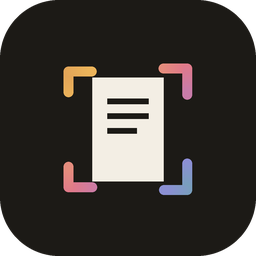
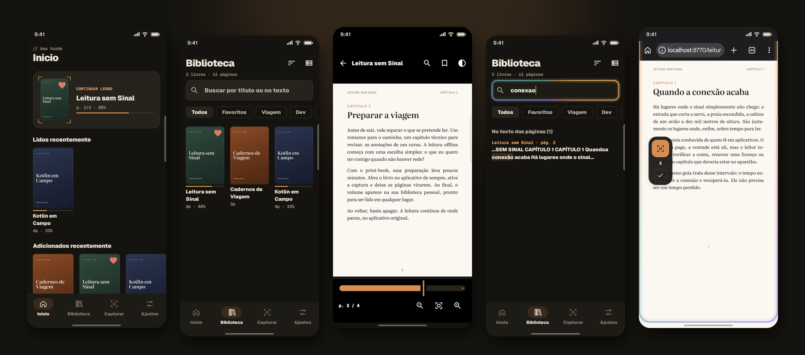
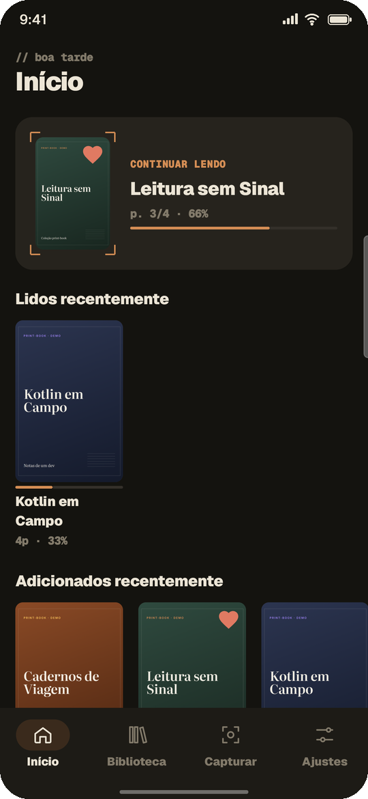
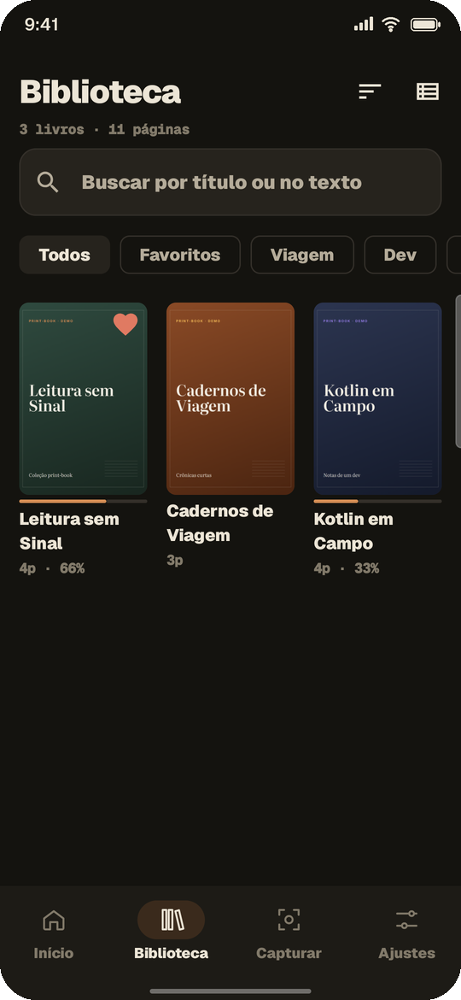
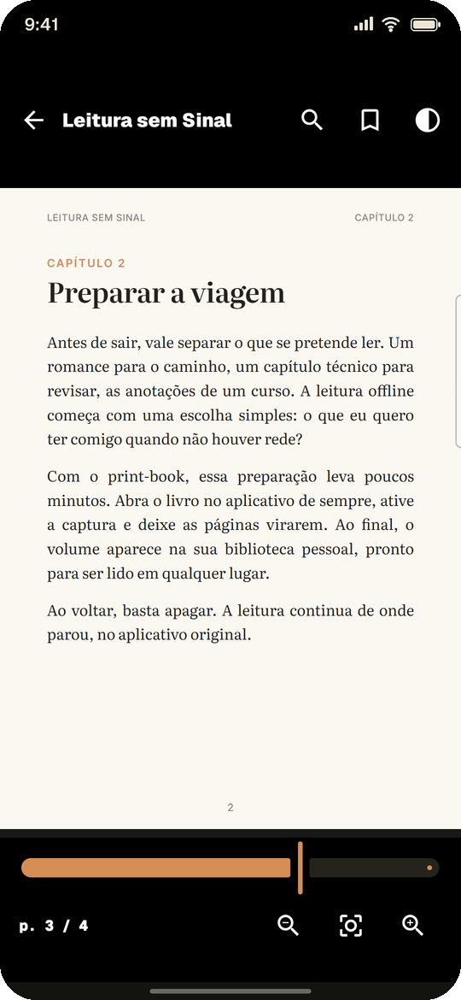
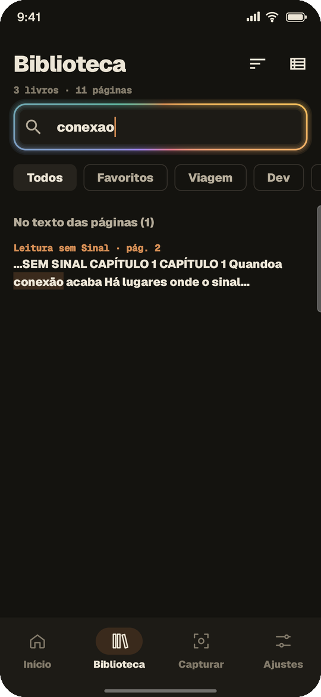
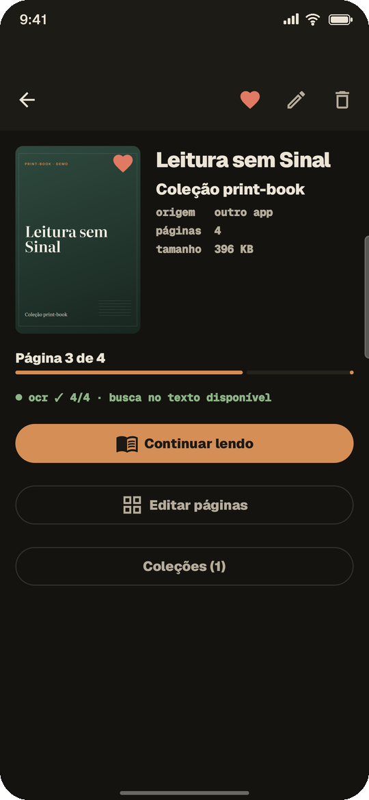
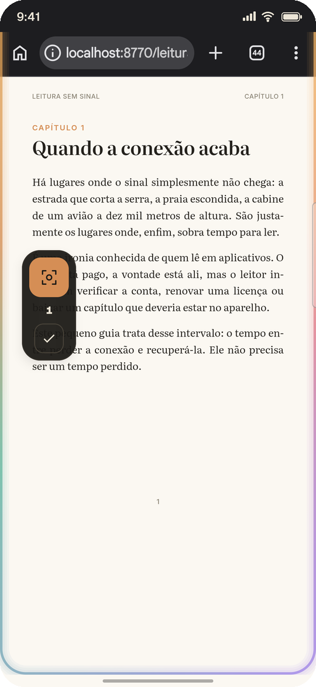
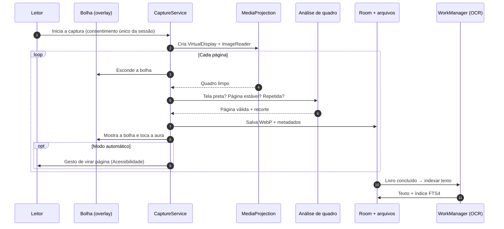
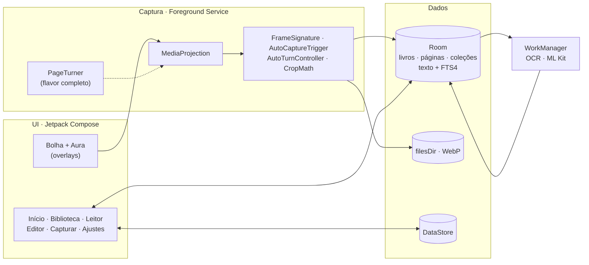

<div align="center">



# print-book

### Leitura offline para quem não pode parar de ler.

Um organizador de leitura para Android que preserva o acesso aos livros quando a conexão desaparece: em viagens, no transporte, em áreas rurais ou em qualquer lugar sem sinal.

[](https://kotlinlang.org)
[](https://developer.android.com/compose)
[](#começando)
[](#qualidade)
[](#privacidade-e-uso-responsável)



</div>

<details>
<summary><b>English summary</b></summary>

**print-book** is an Android app (Kotlin, Jetpack Compose, Material 3) that keeps readers reading when connectivity is gone. While users still have access to their content, it captures the pages their reading app displays, through a floating overlay built on MediaProjection, and turns them into an offline library with a full reader: zoom, filters, bookmarks, on-device OCR full-text search (ML Kit + SQLite FTS4) and PDF export. Captured pages are stored privately on the device and can be deleted at any time.

Engineering highlights: single-consent capture sessions (Android 14+), frame-stability and duplicate detection with pure, unit-tested Kotlin, an accessibility-driven auto page turner isolated in a separate product flavor, a Samsung One UI `Choreographer` pitfall diagnosed and fixed on a real device, and a custom design system with an animated "capture aura" rendered only *after* each frame is taken. The app never bypasses `FLAG_SECURE`.
</details>

---

## Sumário

- [Visão geral](#visão-geral)
- [Destaques](#destaques)
- [Telas](#telas)
- [Funcionalidades](#funcionalidades)
- [Como funciona](#como-funciona)
- [Arquitetura](#arquitetura)
- [Decisões de engenharia](#decisões-de-engenharia)
- [Qualidade](#qualidade)
- [Stack](#stack)
- [Começando](#começando)
- [Roadmap](#roadmap)
- [Privacidade e uso responsável](#privacidade-e-uso-responsável)
- [Autor](#autor)

---

## Visão geral

A leitura digital por assinatura colocou bibliotecas inteiras no bolso, mas trouxe uma dependência pouco discutida: **a conexão**. Muitos aplicativos de leitura precisam de internet para abrir o leitor, validar o acesso ou carregar o próximo capítulo. Quando o sinal some, o leitor perde exatamente o tempo que tinha para ler, numa viagem de férias, num voo, no metrô ou numa região com cobertura instável.

O **print-book** existe para que esse intervalo não interrompa a leitura. Enquanto o leitor ainda tem acesso ao conteúdo, o app captura as páginas exibidas no aplicativo de leitura e as organiza numa biblioteca offline, com uma experiência de leitura completa. Quando a conexão volta, as capturas podem ser apagadas e a leitura continua normalmente na plataforma original.

**Princípios do projeto**
- **Continuidade da leitura:** o objetivo é não perder o hábito nem o tempo de leitura por falta de rede.
- **Respeito ao conteúdo:** só o que já está visível na tela, de conteúdo ao qual o usuário tem acesso. Nenhuma proteção é contornada.
- **Privacidade por padrão:** tudo fica no aparelho, sem conta, sem servidor e sem backup em nuvem.
- **Leitura confortável:** a interface se recolhe para dar espaço ao texto.

---

## Destaques

| | |
|---|---|
| ⚡ **Captura automática** | Vira as páginas sozinho e para no fim do livro: **100 páginas em ~6 minutos**, sem intervenção. |
| 🔎 **Busca no texto, offline** | OCR no próprio aparelho + índice FTS4 que ignora acentos ("aproximacao" encontra "aproximação"). |
| 🎯 **Precisão medida** | **200/200 páginas** capturadas sem perda ou duplicata em teste real; **482/482** páginas indexadas sem falha. |
| 🧱 **Arquitetura limpa** | Single-Activity, MVVM, Hilt, Room, WorkManager; lógica de imagem em **funções puras testadas na JVM**. |
| 🛡️ **Ético por construção** | Respeita `FLAG_SECURE`; automação isolada numa variante de build que nem entra no APK publicável. |
| 🎨 **Design system próprio** | Tokens claro/escuro, tipografia Geist, iconografia e ícone adaptativo próprios, e a animação "aura de captura". |

---

## Telas

<table>
  <tr>
    <td align="center"><br/><sub><b>Início</b>: continuar lendo e prateleiras</sub></td>
    <td align="center"><br/><sub><b>Biblioteca</b>: coleções, favoritos, progresso</sub></td>
    <td align="center"><br/><sub><b>Leitor</b>: zoom, marcadores, filtros</sub></td>
  </tr>
  <tr>
    <td align="center"><br/><sub><b>Busca no texto</b> com OCR offline</sub></td>
    <td align="center"><br/><sub><b>Detalhe</b>: metadados e status do índice</sub></td>
    <td align="center"><br/><sub><b>Captura</b>: bolha flutuante e aura ao salvar</sub></td>
  </tr>
</table>

<sub>Os livros exibidos são conteúdo de demonstração original, criado para estas imagens.</sub>

---

## Funcionalidades

**Captura**
- Botão flutuante sobre o aplicativo de leitura (overlay em Compose), que se esconde no instante da captura.
- Três modos:
  - **Manual:** um toque por página.
  - **Semiautomático:** o leitor vira a página e o app captura quando a tela estabiliza.
  - **Automático:** o app vira as páginas e reconhece o fim do livro.
- Recorte automático das barras do leitor, dos rodapés de progresso e das margens, por perfil de aplicativo.
- Descarte de páginas repetidas e aviso imediato se o aplicativo de origem bloquear capturas.
- Duas qualidades de armazenamento: **Máxima** (WebP sem perda) e **Econômica** (−46% de espaço).

**Leitura**
- Zoom por pinça, duplo toque e botões; virada de página por toque nas bordas e pelas teclas de volume.
- Filtros de cor: original, noturno, sépia e escurecido.
- Marcadores, barra de progresso e retomada automática de onde parou.

**Organização**
- Biblioteca em grade ou lista, favoritos, coleções, ordenação e busca por título **e** por conteúdo.
- Editor de páginas: reordenar, girar, definir capa e excluir.
- Exportação para PDF (edição completa).

---

## Como funciona



---

## Arquitetura



<details>
<summary><b>Estrutura do projeto</b></summary>

```
app/src/
├── main/java/com/printbook/app/
│   ├── capture/
│   │   ├── analysis/      # funções puras: estabilidade, duplicatas, tela preta, fim do livro
│   │   ├── overlay/       # bolha e aura (janelas TYPE_APPLICATION_OVERLAY em Compose)
│   │   ├── processing/    # quadro bruto → página recortada
│   │   ├── profile/       # perfis de recorte por aplicativo
│   │   ├── projection/    # sessão MediaProjection (VirtualDisplay + ImageReader)
│   │   └── service/       # foreground service e estado da captura
│   ├── data/              # Room (DAOs, entidades, FTS), arquivos, DataStore, repositórios, busca
│   ├── work/              # OCR em segundo plano (WorkManager + Hilt)
│   ├── export/            # contrato de exportação
│   ├── di/                # módulos Hilt
│   └── ui/                # telas Compose, componentes, navegação e tema
├── pessoal/               # edição completa: virada automática (Acessibilidade) e PDF
├── loja/                  # edição para lojas: sem automação e sem exportação
└── test/                  # testes unitários (JVM)
```
</details>

Documento completo de arquitetura: [`docs/SYSTEM_DESIGN.md`](docs/SYSTEM_DESIGN.md).

---

## Decisões de engenharia

| Desafio | Solução |
|---|---|
| O Android 14+ exige consentimento a **cada sessão** de captura | Uma sessão mantém **um único** `VirtualDisplay` vivo; um consentimento cobre o livro inteiro. |
| Capturar a tela **sem** a própria bolha aparecer | A bolha é escondida via alpha da janela, o app aguarda o compositor e só aceita quadros posteriores. Validado em 100% das páginas verificadas. |
| Na **One UI (Samsung)**, a captura travava sem erro | Diagnóstico em aparelho: o `Choreographer` é pausado com o app em segundo plano. A espera passou a usar tempo e chegada de quadros, com timeout. |
| Saber **quando** capturar sem o usuário tocar | `AutoCaptureTrigger`: máquina de estados sobre assinaturas de quadro (referência → mudança → estabilidade). |
| Detectar páginas repetidas e o **fim do livro** | Diferença média absoluta em miniaturas de luminância, mais robusta que hashes de 64 bits para páginas de texto. Também detecta a troca de tela do leitor (ex.: tela de loja no fim de uma amostra). |
| Overlay em tela cheia **sem bloquear toques** | Janela intocável com opacidade 0,8, o limite do Android para toques atravessarem sobreposições. |
| Automação sem comprometer a publicação | *Product flavors* + Hilt: o código de Acessibilidade existe só na edição completa e **não entra** no APK da edição para lojas. |
| Busca útil em texto de OCR | FTS4 com `unicode61 remove_diacritics`, consultas por prefixo sanitizadas e trechos destacados com `snippet()`. |

---

## Qualidade

**Testes unitários (JVM):** 32 testes cobrindo detecção de tela preta, gatilho de captura, controlador do modo automático, recorte e utilitários de busca.

```bash
./gradlew :app:testPessoalDebugUnitTest
```

**Medições em aparelho real** (Galaxy A56, Android 17), com metodologia e números em [`docs/medicoes-fase1.md`](docs/medicoes-fase1.md):

| Cenário | Resultado |
|---|---|
| Captura automática | **100/100 páginas em 5 min 47 s**, 0 duplicatas, parada automática |
| Captura semiautomática (2 livros) | **200/200 páginas**, nenhuma perdida ou repetida |
| Fim do livro | Detectado sem salvar a tela seguinte à última página |
| OCR offline | **482/482 páginas, 0 falhas**, de 0,4 a 1,7 s por página |
| Qualidade Econômica | **−46% de espaço** com texto nítido em resolução real |

---

## Stack

| Área | Tecnologias |
|---|---|
| Linguagem e UI | Kotlin 2.4 · Jetpack Compose · Material 3 · Navigation Compose (rotas tipadas) |
| Arquitetura | MVVM · Hilt · Coroutines e Flow |
| Persistência | Room (AutoMigration, FTS4) · DataStore · armazenamento privado em `filesDir` |
| Captura | MediaProjection · VirtualDisplay · ImageReader · Foreground Service · overlays · AccessibilityService |
| Imagem e texto | WebP · ML Kit Text Recognition (on-device) |
| Leitor | Telephoto (zoom com subsampling) · Coil 3 |
| Background | WorkManager com `@HiltWorker` |
| Testes | JUnit · Truth · Turbine · kotlinx-coroutines-test |

---

## Começando

**Requisitos:** Android Studio recente (AGP 9), JDK 17+ e um aparelho com Android 11 ou superior.

```bash
git clone https://github.com/Carloseduardo-dev/print-book.git
cd print-book

# Edição completa (inclui virada automática e exportação PDF)
./gradlew :app:installPessoalDebug

# Edição para lojas (sem automação e sem exportação)
./gradlew :app:installLojaDebug
```

| Variante | Público | Diferenças |
|---|---|---|
| `pessoal` | Distribuição direta (sideload) | Virada automática por Acessibilidade e exportação PDF |
| `loja` | Base para publicação em lojas | Sem automação e sem exportação, alinhada às políticas das lojas |

No Android Studio, escolha a variante em **View → Tool Windows → Build Variants**.

---

## Roadmap

- [x] Captura manual, semiautomática e automática
- [x] Biblioteca, leitor e editor de páginas
- [x] OCR offline, busca no texto e exportação PDF
- [x] Design system e identidade visual próprios
- [ ] Modo Turbo: captura em ~1 s por página
- [ ] Leitura em voz alta sobre o texto reconhecido
- [ ] Publicação da edição para lojas

**Visão:** um "modo viagem" para leitura offline tem espaço para virar parceria com as próprias plataformas de leitura, de forma oficial e licenciada, ampliando o acesso de quem lê.

---

## Privacidade e uso responsável

- O print-book captura **apenas o que já está visível na tela**, a partir de conteúdo ao qual o usuário tem acesso legítimo, para leitura pessoal offline.
- **Nunca contorna proteções:** se um aplicativo bloqueia capturas de tela (`FLAG_SECURE`), o print-book detecta a tela preta, avisa e interrompe.
- As páginas ficam **somente no aparelho**: fora da galeria, fora do backup em nuvem, sem conta e sem servidor.
- O usuário pode apagar qualquer livro a qualquer momento. A recomendação é remover as capturas quando o acesso à internet voltar.
- O serviço de Acessibilidade, presente só na edição completa, apenas executa gestos de virar página e identifica qual app está em primeiro plano. Ele **não lê** o conteúdo das telas.

O projeto não tem vínculo com nenhuma plataforma de leitura. Marcas citadas no código pertencem aos respectivos titulares.

---

## Autor

**Carlos Eduardo Ferreira**, desenvolvedor Android.

[](https://github.com/Carloseduardo-dev)

Fontes Geist sob [SIL Open Font License](docs/licenses/Geist-OFL.txt). © Carlos Eduardo Ferreira. Todos os direitos reservados.
