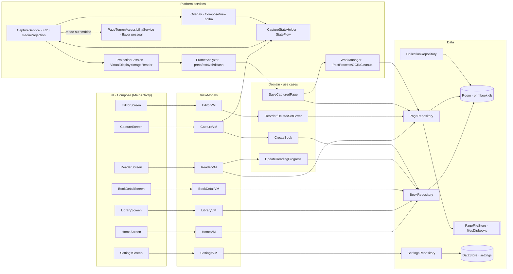
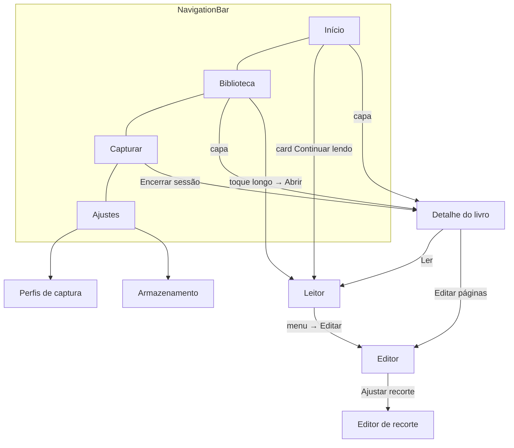
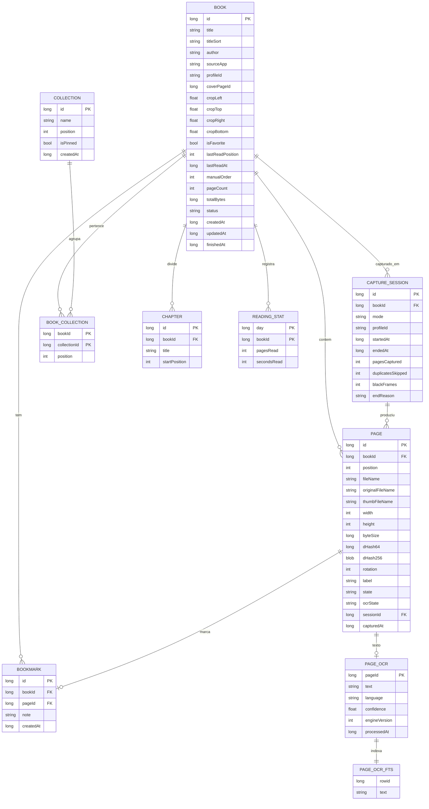
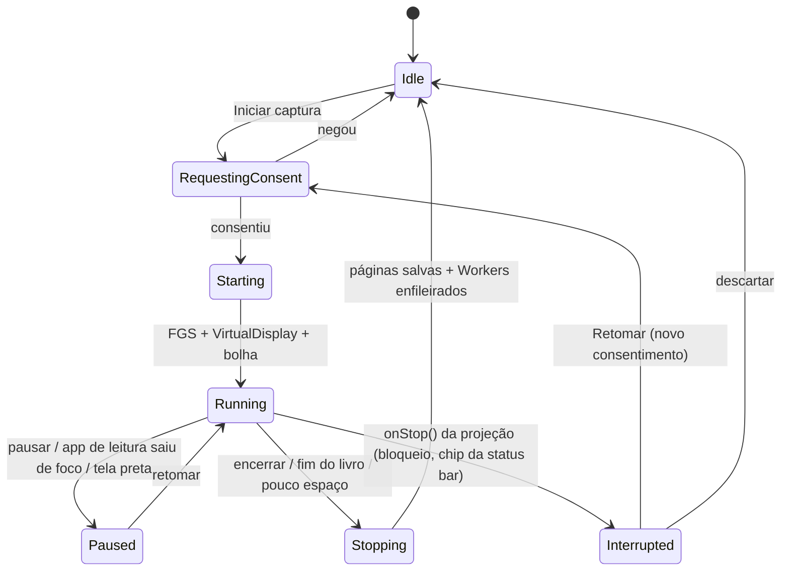
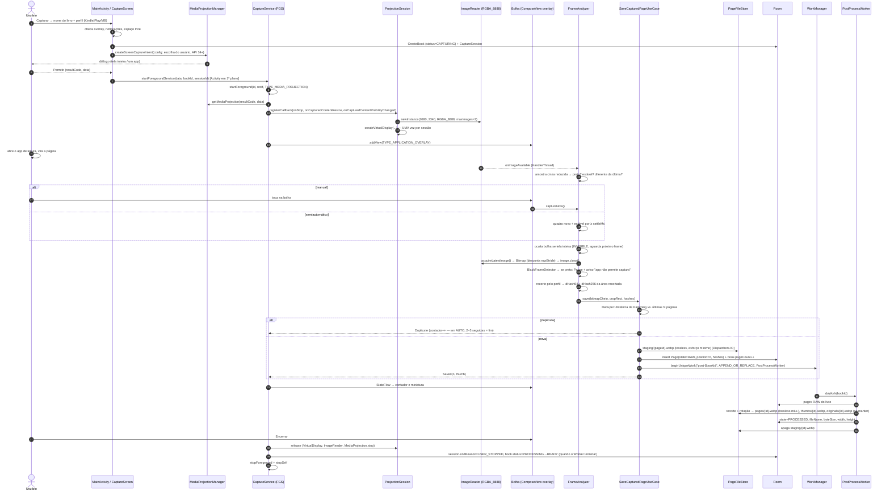
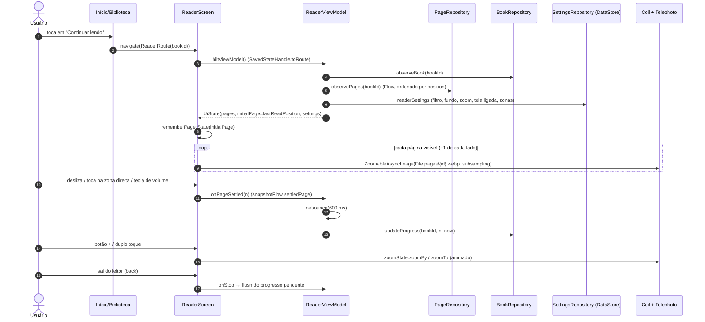

# print-book: System Design

> Versão 1.0, 2026-11-10
> Fontes: `reports/Viabilidade app print book.md` (viabilidade) e testes no aparelho (Galaxy A56, Android 17 / API 37, 1080×2340).
> Projeto: raiz deste repositório (`PrintBook/`), iniciado a partir do template Empty Activity com Compose.

---

## 0. Resumo executivo

O print-book captura, com o consentimento do usuário, as páginas que um app de leitura exibe na tela. Ele organiza essas capturas em "print-books" e oferece uma experiência de leitura offline, com estante, leitor com zoom, favoritos, coleções, edição de páginas e, mais tarde, busca por OCR.

**Premissa validada no aparelho:** Kindle, Play Livros e Minha Biblioteca **não** definem `FLAG_SECURE` nas páginas do Galaxy A56, então a captura via MediaProjection funciona. Isso corresponde ao cenário A do relatório de viabilidade: o roadmap completo é viável.

Decisões principais:

| # | Decisão | Motivo |
|---|---|---|
| D1 | Single-Activity, Jetpack Compose, Navigation Compose tipada, 4 abas (Início, Biblioteca, Capturar, Ajustes) | Padrão moderno. Evita a fragmentação em várias Activities e fragments trocados por tag. |
| D2 | MVVM + use cases + repositórios. Coroutines/Flow. Hilt. | Testabilidade. Sem service locator estático. |
| D3 | Room para metadados, imagens em `filesDir`, DataStore para preferências | Privado, sem permissões de armazenamento, fora da galeria |
| D4 | `CaptureService` (FGS `mediaProjection`) com **uma sessão = um VirtualDisplay + ImageReader** e estado em `StateFlow` | Regra de token único do Android 14+. Um consentimento cobre o lote inteiro. |
| D5 | Gravar rápido na captura e pós-processar no WorkManager (`beginUniqueWork(bookId)`) | Mantém a bolha responsiva e permite retry |
| D6 | Dedupe por **dHash 16×16** calculado só na área recortada (sem rodapé) | Rodapés como "Localização X de Y" mudam a cada página e quebrariam o hash |
| D7 | Recorte por **perfil de app** em coordenadas normalizadas, copiado para o livro | Funciona para Kindle, Play Livros e Minha Biblioteca e continua ajustável por livro |
| D8 | Recorte **não destrutivo**: o original fica guardado (opção de descartar) | Permite re-recortar no editor sem recapturar |
| D9 | Flavors `pessoal` (AccessibilityService + exportação) e `loja` (sem ambos) | As partes de maior risco nunca entram na build publicável |
| D10 | Leitor: `HorizontalPager` + Telephoto (`ZoomableAsyncImage`, subsampling), botões +/-, duplo toque, filtros de cor | Modelo de leitor de mangá (Mihon), não de leitor de texto |
| D11 | **Nunca contornar `FLAG_SECURE`.** Se o quadro vier preto, o app avisa e pausa. | Linha legal (art. 107 da Lei 9.610/98) e técnica |

---

## 1. Objetivos

1. Transformar, com poucos toques, um livro aberto num app de leitura num print-book local, com 100 ou mais páginas por sessão e um único consentimento.
2. Ler offline com conforto: paginação fluida, zoom (pinça, duplo toque, +/-), modo noturno e progresso salvo.
3. Organizar: nome, capa, favoritos, coleções, ordenação e busca.
4. Editar: reordenar, apagar, girar, definir capa e ajustar o recorte.
5. Evoluir para OCR (busca full-text, TTS) e automação sem reescrever a base.
6. Manter separados o núcleo "seguro" (captura iniciada pelo usuário, armazenamento privado) e a camada pessoal "arriscada" (acessibilidade, exportação).

### Não objetivos

- Contornar qualquer proteção (FLAG_SECURE, DRM, telas seguras), usar root ou módulos Xposed.
- Sincronizar na nuvem, compartilhar ou distribuir conteúdo.
- Renderizar texto refluível (EPUB/PDF de terceiros). O print-book lida com **imagens**.
- Analytics remoto (Firebase etc.).

---

## 2. Requisitos

### 2.1 Funcionais

| ID | Requisito | Fase |
|---|---|---|
| RF01 | Fluxo de permissões guiado: sobreposição (`SYSTEM_ALERT_WINDOW`), notificações (`POST_NOTIFICATIONS`) e consentimento de MediaProjection por sessão | MVP |
| RF02 | Criar um livro ao iniciar a captura (nome digitado ou automático, por exemplo "Kindle 10/11 14:32") e escolher o perfil do app de origem | MVP |
| RF03 | Bolha flutuante arrastável com contador, estado (gravando, pausado, aviso) e menu (pausar, modo, encerrar) | MVP |
| RF04 | Captura **manual** (tocar na bolha) | MVP |
| RF05 | Captura **semiautomática**: o usuário vira a página e o app detecta quadro novo e estável, então captura | MVP |
| RF06 | Detecção de **tela preta ou protegida**: aviso "Este app não permite captura" e pausa | MVP |
| RF07 | Dedupe por hash perceptual. Páginas repetidas não são salvas. | MVP |
| RF08 | Recorte por perfil de app (Kindle, Play Livros, Minha Biblioteca, Genérico) com ajuste por livro | MVP |
| RF09 | Retomar sessão após bloqueio de tela ou parada do sistema (novo consentimento) | MVP |
| RF10 | Início: "Continuar lendo", Recentes, Favoritos | MVP |
| RF11 | Biblioteca em grade/lista, busca por título, ordenação (recentes, título, data de criação; manual na fase 3) e filtro persistentes | MVP |
| RF12 | Leitor paginado: pinça, duplo toque, botões +/-, barra de progresso "n / total", tela ligada, modo imersivo | MVP |
| RF13 | Progresso de leitura salvo automaticamente | MVP |
| RF14 | Editor: renomear, reordenar, apagar (com desfazer), definir capa, girar, excluir livro | MVP |
| RF15 | Ajustes básicos: tema, modo de captura padrão, sensibilidade de estabilidade, perfis, armazenamento | MVP |
| RF16 | Favoritar e desfavoritar livros | MVP |
| RF17 | Modo **automático** (flavor `pessoal`): AccessibilityService vira a página (`dispatchGesture`) com intervalo configurável e parada por duplicatas | Fase 3 |
| RF18 | Filtros de leitura: inverter (noturno), sépia, escurecer, cor de fundo, zonas de toque, teclas de volume | Fase 3 |
| RF19 | Coleções (criar, renomear, ordenar, fixar), marcadores, ordenação manual da biblioteca | Fase 3 |
| RF20 | OCR on-device (ML Kit) em Worker, busca FTS, rótulos de página extraídos do rodapé | Fase 4 |
| RF21 | TTS pt-BR sobre o texto do OCR, capítulos manuais, estatísticas e metas | Fase 4 |
| RF22 | Exportar PDF/CBZ (flavor `pessoal`) | Fase 4 |

### 2.2 Não funcionais

| ID | Requisito | Meta |
|---|---|---|
| RNF01 | Latência do toque na bolha até a página salva (staging) | ≤ 400 ms (p95) |
| RNF02 | Throughput no modo semiautomático | ≥ 1 página/s sem perda |
| RNF03 | Memória durante a captura | Sem OOM em 300 páginas. Buffers reutilizados. Pico < 150 MB. |
| RNF04 | Leitor | Virada de página a 60 fps, abertura de livro < 500 ms, zoom sem serrilhado (subsampling) |
| RNF05 | Armazenamento | ≤ 30 MB por 100 páginas (sem originais) e aviso antes de faltar espaço (< 500 MB livres) |
| RNF06 | Robustez | A parada da projeção nunca perde as páginas já salvas. Workers são idempotentes. |
| RNF07 | Privacidade | Tudo em `filesDir`, sem rede (nenhuma permissão `INTERNET` no MVP), sem backup na nuvem das imagens |
| RNF08 | Compatibilidade | minSdk 30, target/compile 37. Recursos de API 34+ ficam atrás de checagem de versão. |
| RNF09 | Testabilidade | Domínio e algoritmos (hash, estabilidade, recorte) 100% testáveis em JVM |
| RNF10 | Acessibilidade | Alvos ≥ 48 dp, `contentDescription` na bolha e nos controles do leitor, TalkBack no app |

### 2.3 Escopo: MVP e futuro

```
MVP (Fases 1–2)                        Futuro
├─ Permissões + consentimento          ├─ F3: Automático (Accessibility, flavor pessoal)
├─ Bolha + manual + semiautomático     ├─ F3: Filtros noturno/sépia, zonas de toque, volume
├─ Tela preta, dedupe, recorte         ├─ F3: Coleções, marcadores, ordenação manual
├─ Room + filesDir + WorkManager       ├─ F4: OCR + FTS + rótulos de página
├─ Início, Biblioteca, Leitor, Editor  ├─ F4: TTS, capítulos, estatísticas, metas
├─ Favoritos, progresso                ├─ F4: Exportação PDF/CBZ (pessoal)
└─ Ajustes básicos (DataStore)         └─ F5: Flavor loja (avaliação)
```

---

## 3. Alinhamento com o projeto atual

| Item | Hoje | Proposta |
|---|---|---|
| `namespace` / `applicationId` | `com.example.printbook` | Manter o pacote no MVP. Flavor `pessoal` com `applicationIdSuffix = ".pessoal"`. **Trocar o `applicationId` antes de qualquer publicação** (o Play rejeita `com.example`). |
| AGP | 9.3.3 (Kotlin embutido no AGP 9; só o plugin `kotlin.compose` está declarado) | Manter. Adicionar plugins `ksp`, `hilt`, `kotlin.serialization` (rotas tipadas) e `androidx.room` (schema). |
| Kotlin | 2.2.10 | Manter. KSP na versão casada com 2.2.10. |
| Gradle / JDK | Wrapper 9.5.0, toolchain JDK 25 (daemon). `compileOptions` em Java 11. | Subir `sourceCompatibility`/`targetCompatibility` para 17 (recomendado para Hilt/Room recentes) |
| compileSdk / targetSdk | 37 / 37 | Manter |
| minSdk | 24 | **Subir para 30**: `WEBP_LOSSLESS`, `takeScreenshot` e APIs de janela modernas. Recursos de API 34+ (escolha de app no consentimento, callbacks de visibilidade e redimensionamento) ficam atrás de checagem de versão. |
| Compose BOM | 2026.02.01 | Manter |
| core-ktx / lifecycle / activity-compose | 1.19.0 / 2.11.0 / 1.13.0 | Manter. Adicionar `lifecycle-viewmodel-compose`, `lifecycle-runtime-compose` e `lifecycle-service`. |
| R8 | `optimization { enable = false }` no release | Ligar no release do flavor `loja`. No `pessoal`, opcional. |
| Backup | `allowBackup="true"` | `allowBackup="false"` ou regras que excluam `files/books/` (as imagens não devem ir para o backup do Google) |

---

## 4. Arquitetura

### 4.1 Camadas

```
┌──────────────────────────────────────────────────────────────┐
│ UI (Compose)  telas · componentes · tema · navegação · overlay│
├──────────────────────────────────────────────────────────────┤
│ ViewModels    StateFlow<UiState> · eventos · SavedStateHandle │
├──────────────────────────────────────────────────────────────┤
│ Domain        modelos puros · use cases · interfaces          │
├──────────────────────────────────────────────────────────────┤
│ Data          repositórios · Room (DAOs) · PageFileStore ·    │
│               DataStore · mapeadores                          │
├──────────────────────────────────────────────────────────────┤
│ Platform      CaptureService (FGS) · ProjectionSession ·      │
│ services      FrameAnalyzer · Workers · PageTurner (A11y)     │
└──────────────────────────────────────────────────────────────┘
```

Regras:
- A UI só fala com ViewModels. Os ViewModels só falam com use cases ou repositórios (interfaces do domain).
- O domain não importa nada de Android (exceto anotações). Algoritmos de imagem puros (`DHash`, `StabilityDetector`, `CropMath`) trabalham com `IntArray`/`ByteBuffer` e ficam testáveis em JVM.
- Os serviços de plataforma recebem dependências por Hilt (`@AndroidEntryPoint` no Service, `@HiltWorker` nos Workers). **Nenhum estado em campo `static`** (nada de ViewModel ou serviço guardado em variável global).
- O estado da captura vive num `CaptureStateHolder` `@Singleton` (StateFlow), observado pelo Service, pela bolha e pela aba Capturar.

### 4.2 Pacotes (módulo único `:app` no início)

Começar com um módulo só e pacotes bem separados. Extrair `:core:*` só se o build ficar lento.

```
com.example.printbook
├─ PrintBookApp.kt                 @HiltAndroidApp, canais de notificação, WorkManager config
├─ MainActivity.kt                 @AndroidEntryPoint, edge-to-edge, NavHost
├─ di/                             DatabaseModule, DataStoreModule, DispatchersModule, CaptureModule
├─ ui/
│  ├─ navigation/                  Routes.kt (@Serializable), PrintBookNavHost.kt, BottomBar.kt
│  ├─ theme/                       Color, Type, Theme (claro/escuro/dinâmico)
│  ├─ components/                  BookCover, BookGrid, EmptyState, ConfirmDialog, PageThumb
│  ├─ home/                        HomeScreen, HomeViewModel
│  ├─ library/                     LibraryScreen, LibraryViewModel, LibraryFilterSheet
│  ├─ capture/                     CaptureScreen (setup/status), CaptureViewModel, PermissionGate
│  ├─ settings/                    SettingsScreen, SettingsViewModel, ProfilesScreen, StorageScreen
│  ├─ bookdetail/                  BookDetailScreen, BookDetailViewModel
│  ├─ reader/                      ReaderScreen, ReaderViewModel, ReaderChrome, ColorFilters
│  └─ editor/                      EditorScreen, EditorViewModel, CropEditorScreen
├─ domain/
│  ├─ model/                       Book, Page, Bookmark, Collection, CaptureProfile, CaptureMode, ...
│  ├─ repository/                  BookRepository, PageRepository, CollectionRepository, SettingsRepository (interfaces)
│  └─ usecase/                     CreateBookUseCase, SaveCapturedPageUseCase, ReorderPagesUseCase,
│                                  DeletePagesUseCase, SetCoverUseCase, UpdateReadingProgressUseCase, ...
├─ data/
│  ├─ db/                          PrintBookDatabase, entity/, dao/, Converters, migrations/
│  ├─ files/                       PageFileStore (caminhos, escrita atômica, limpeza), StorageStats
│  ├─ prefs/                       SettingsDataStore
│  └─ repository/                  *RepositoryImpl
├─ capture/
│  ├─ service/                     CaptureService (FGS), CaptureNotification, CaptureStateHolder
│  ├─ projection/                  ProjectionSession (MediaProjection + VirtualDisplay + ImageReader)
│  ├─ overlay/                     OverlayWindowManager, BubbleContent (Compose), ServiceLifecycleOwner
│  ├─ analysis/                    FrameSampler, BlackFrameDetector, StabilityDetector, DHash, Deduper
│  ├─ profile/                     CaptureProfiles (Kindle, PlayBooks, MinhaBiblioteca, Generic), CropMath
│  └─ PageTurner.kt                interface (NoOp no flavor loja)
└─ work/                           PostProcessWorker, OcrWorker (F4), CleanupWorker, WorkScheduler

src/pessoal/java/.../automation/   PageTurnerAccessibilityService, AccessibilityPageTurner, AutoCaptureLoop
src/pessoal/java/.../export/       PdfExporter, CbzExporter (F4)
src/loja/java/.../automation/      NoOpPageTurner (binding Hilt)
```

### 4.3 Diagrama de componentes



### 4.4 Injeção de dependência (Hilt)

| Módulo | Fornece | Escopo |
|---|---|---|
| `DatabaseModule` | `PrintBookDatabase`, DAOs | `@Singleton` |
| `DataStoreModule` | `DataStore<Preferences>` | `@Singleton` |
| `DispatchersModule` | `@IoDispatcher`, `@DefaultDispatcher` (testes injetam `StandardTestDispatcher`) | `@Singleton` |
| `RepositoryModule` | `@Binds` das interfaces do domain para as `*Impl` | `@Singleton` |
| `CaptureModule` | `CaptureStateHolder`, `CaptureProfiles`, `FrameAnalyzerFactory` | `@Singleton` |
| `AutomationModule` (por flavor) | `PageTurner`: `AccessibilityPageTurner` (pessoal) ou `NoOpPageTurner` (loja) | `@Singleton` |
| `WorkModule` | `HiltWorkerFactory` via `Configuration.Provider` na Application (remover o inicializador padrão do WorkManager no manifesto) | — |

### 4.5 Navegação

Navigation Compose 2.10.x com rotas `@Serializable` tipadas. Navigation 3 (1.1.x) é uma alternativa válida. A escolha é pelo Navigation Compose por maturidade e pela integração com `hiltViewModel()` e `SavedStateHandle.toRoute()`.

```kotlin
// Abas (top-level)
@Serializable object HomeRoute          // Início
@Serializable object LibraryRoute       // Biblioteca (filtros: Todos / Favoritos / Coleções)
@Serializable object CaptureRoute       // Capturar
@Serializable object SettingsRoute      // Ajustes
// Rotas de detalhe (sem bottom bar)
@Serializable data class BookDetailRoute(val bookId: Long)
@Serializable data class ReaderRoute(val bookId: Long, val startPage: Int? = null)
@Serializable data class EditorRoute(val bookId: Long)
@Serializable data class CropEditorRoute(val bookId: Long)
@Serializable data class CollectionRoute(val collectionId: Long)        // F3
@Serializable object CaptureProfilesRoute
@Serializable object StorageRoute
```



- A bottom bar fica visível só nas 4 rotas de aba. As abas usam `saveState`/`restoreState` e `launchSingleTop`.
- Deep link interno: a notificação da captura abre `CaptureRoute`, e a notificação "sessão encerrada" abre `BookDetailRoute(bookId)`.
- O Leitor usa tela cheia (imersivo) e predictive back. Ao sair, a posição é salva.

---

## 5. Modelo de dados (Room)

### 5.1 Diagrama ER



### 5.2 Entidades, campos e índices

**`books`** (MVP)

| Campo | Tipo | Notas |
|---|---|---|
| `id` | `Long` PK autoGenerate | |
| `title` | `String` | Obrigatório. Padrão: "{App} {data hora}". |
| `titleSort` | `String` | Minúsculo, sem acentos e sem artigos iniciais ("o", "a", "the"). **Índice.** |
| `author` | `String?` | Opcional (editável) |
| `sourceApp` | `String` (enum `SourceApp`: `KINDLE`, `PLAY_BOOKS`, `MINHA_BIBLIOTECA`, `OTHER`) | |
| `profileId` | `String` | Perfil usado na captura |
| `coverPageId` | `Long?` | **Sem FK** (evita ciclo `books`↔`pages`). O repositório limpa o campo ao apagar a página. Nulo significa usar a página de posição 0. |
| `cropLeft/Top/Right/Bottom` | `Float` (0..1) | Copiados do perfil na criação. Ajustáveis no editor de recorte. |
| `isFavorite` | `Boolean` | **Índice** |
| `lastReadPosition` | `Int` | Padrão 0 |
| `lastReadAt` | `Long?` (epoch ms) | **Índice** (Continuar lendo / Recentes) |
| `manualOrder` | `Int` | Ordenação manual (F3) |
| `pageCount` | `Int` | Desnormalizado, atualizado na mesma transação de insert e delete de páginas |
| `totalBytes` | `Long` | Desnormalizado (tela de armazenamento) |
| `status` | `String` (`CAPTURING`, `PROCESSING`, `READY`) | |
| `createdAt`, `updatedAt` | `Long` | |
| `finishedAt` | `Long?` | Marcado como lido (F3) |

**`pages`** (MVP)

| Campo | Tipo | Notas |
|---|---|---|
| `id` | `Long` PK | **Também nomeia os arquivos** (`{id}.webp`). Reordenar não renomeia arquivos. |
| `bookId` | `Long` FK → `books.id` `ON DELETE CASCADE` | **Índice** |
| `position` | `Int` | Índice físico 0..n-1. **Índice único `(bookId, position)`**. |
| `fileName` | `String?` | Relativo: `pages/{id}.webp` (nulo até o Worker terminar) |
| `originalFileName` | `String?` | `originals/{id}.webp` (quadro inteiro). Nulo se o usuário descartou os originais. |
| `thumbFileName` | `String?` | `thumbs/{id}.webp` |
| `width`, `height` | `Int` | Da imagem recortada |
| `byteSize` | `Long` | |
| `dHash64` | `Long` | dHash 8×8, pré-filtro rápido |
| `dHash256` | `ByteArray` (32 B) | dHash 16×16, comparação fina |
| `rotation` | `Int` (0/90/180/270) | Aplicada na exibição |
| `label` | `String?` | Rótulo exibido ("Capa", "Loc. 1234", "p. 17"). Vem do OCR do rodapé (F4) ou do usuário. Separa o rótulo impresso ("Capa", "xii") da posição física. |
| `state` | `String` (`RAW`, `PROCESSED`, `FAILED`) | **Índice** `(bookId, state)` para o Worker |
| `ocrState` | `String` (`NONE`, `PENDING`, `DONE`, `FAILED`) | F4 |
| `sessionId` | `Long?` FK → `capture_sessions.id` `ON DELETE SET NULL` | **Índice** |
| `capturedAt` | `Long` | |

Reordenação com índice único: numa transação, primeiro `UPDATE pages SET position = -position - 1 WHERE bookId = ?` e depois a gravação das posições finais. Assim nenhuma posição colide no meio.

**`bookmarks`** (F3): `id`, `bookId` FK CASCADE (índice), `pageId` FK CASCADE (**índice único**: um marcador por página), `note: String?`, `createdAt`.

**`collections`** (F3): `id`, `name` (índice único `COLLATE NOCASE`), `position`, `isPinned`, `createdAt`.

**`book_collection`** (F3): PK composta `(bookId, collectionId)`, ambos FK CASCADE, `position` (ordem dentro da coleção), índice em `collectionId`.

**`capture_sessions`** (MVP): `id`, `bookId` FK CASCADE (índice), `mode` (`MANUAL`, `SEMI_AUTO`, `AUTO`), `profileId`, `startedAt`, `endedAt?`, `pagesCaptured`, `duplicatesSkipped`, `blackFrames`, `endReason?` (`USER_STOPPED`, `PROJECTION_STOPPED`, `SCREEN_LOCKED`, `BLACK_SCREEN`, `END_OF_BOOK`, `LOW_STORAGE`, `ERROR`). Serve para retomar e para diagnóstico.

**`page_ocr`** (F4): `pageId` PK + FK CASCADE, `text`, `language`, `confidence`, `engineVersion`, `processedAt`.

**`page_ocr_fts`** (F4): `@Fts4(contentEntity = PageOcrEntity::class, tokenizer = TOKENIZER_UNICODE61, tokenizerArgs = ["remove_diacritics=2"])` com a coluna `text`. Isso permite buscar "acao" e achar "ação". Busca: `JOIN page_ocr_fts ON rowid = page_ocr.rowid WHERE page_ocr_fts MATCH :q`, com `snippet()` para o trecho.

**`chapters`** (F4): `id`, `bookId` FK CASCADE, `title`, `startPosition` (índice `(bookId, startPosition)`).

**`reading_stats`** (F4): PK `(day, bookId)`, `pagesRead`, `secondsRead`.

### 5.3 DAOs e consultas principais

- `BookDao.observeContinueReading(limit)`: `WHERE lastReadAt IS NOT NULL AND status='READY' ORDER BY lastReadAt DESC`.
- `BookDao.observeLibrary(query, filter, sort)`: `@RawQuery(observedEntities = [BookEntity::class])` ou consultas separadas por ordenação, com `titleSort LIKE :q || '%'` OR `title LIKE '%' || :q || '%'`.
- `BookDao.observeBookWithCover(id)`: `@Relation` ou `JOIN` para resolver o arquivo da capa.
- `PageDao.observePages(bookId)`: `Flow<List<PageEntity>>` ordenado por `position`. O leitor e o editor usam a mesma consulta.
- `PageDao.recentHashes(bookId, limit)`: carrega os hashes na memória ao iniciar ou retomar a sessão (dedupe).
- `PageDao.pendingForProcessing(bookId)`: `state='RAW'`.
- `BookDao.updateProgress(id, position, now)`: `UPDATE` pontual, chamado com debounce.

Configuração: `exportSchema = true` com `room { schemaDirectory("$projectDir/schemas") }`. `AutoMigration` quando possível e `MigrationTestHelper` nos testes. `TypeConverters` para enums (como `String`, mais estável que o ordinal).

### 5.4 Armazenamento em disco

```
filesDir/
└─ books/
   └─ {bookId}/
      ├─ originals/{pageId}.webp   quadro inteiro (WebP lossless), opcional ("manter originais")
      ├─ staging/{pageId}.webp     gravação rápida na captura (lossless, esforço mínimo); apagado pelo Worker
      ├─ pages/{pageId}.webp       recortado e girado, WebP lossless (esforço máximo)
      └─ thumbs/{pageId}.webp      ~300 px de largura, WebP lossy q≈80
```

- O banco guarda **caminhos relativos** a `filesDir/books/{bookId}/`. Usar `filesDir` desde o início evita migrações de armazenamento externo → interno no futuro.
- Escrita atômica: grava em `*.tmp` e faz `renameTo`. O Worker só marca `PROCESSED` depois do rename.
- Para apagar um livro, o repositório apaga as linhas (cascade) e enfileira um `CleanupWorker` que remove o diretório. Um varredor de órfãos roda na inicialização (arquivos sem linha, ou linhas sem arquivo → `FAILED`).
- Nada em armazenamento externo e nada na galeria (sem `MediaStore`).

---

## 6. Pipeline de captura

### 6.1 Visão geral



### 6.2 Sequência: overlay → MediaProjection → dedupe → WebP → Room → WorkManager



### 6.3 Ordem de inicialização e regras do Android 14–17

1. **Consentimento por sessão (Android 14+):** cada `createScreenCaptureIntent()` gera um token **de uso único**. Reutilizar o `Intent` de resultado ou chamar `createVirtualDisplay()` duas vezes lança `SecurityException`. Por isso a sessão inteira usa **um** VirtualDisplay. Para retomar depois de uma interrupção, o usuário consente de novo.
2. **FGS antes da projeção:** `startForeground(..., FOREGROUND_SERVICE_TYPE_MEDIA_PROJECTION)` precisa ser chamado **depois** do consentimento e **antes** de `getMediaProjection()`. O serviço é iniciado com a Activity em primeiro plano. Isso evita `ForegroundServiceStartNotAllowedException` (no Android 15+, `SYSTEM_ALERT_WINDOW` só isenta se o overlay já estiver visível).
3. **`MediaProjection.Callback` obrigatório** antes de `createVirtualDisplay()`:
   - `onStop()`: projeção encerrada pelo sistema (bloqueio de tela, chip da status bar do Android 15 QPR1+, outro app iniciando captura). Ação: fechar a sessão com `endReason`, manter o que foi salvo e mostrar a notificação "Sessão interrompida: Retomar".
   - `onCapturedContentVisibilityChanged(isVisible)` (API 34+): na captura de um único app, quando o app de leitura sai de foco, **pausar** a análise. Isso evita capturar a tela do launcher.
   - `onCapturedContentResize(w, h)` (API 34+): recriar o `ImageReader` com o novo tamanho e chamar `virtualDisplay.resize()` + `setSurface()`. Não é preciso criar um novo VirtualDisplay.
4. **Captura de um único app (app screen sharing, Android 14+):** recomendada. A status bar, a barra de navegação, as notificações e (a confirmar no A56) a própria bolha ficam fora do quadro. O quadro pode vir *letterboxed*, então o `FrameSampler` detecta o retângulo útil (bordas pretas uniformes) uma vez por sessão e as coordenadas normalizadas do perfil são aplicadas sobre ele.
5. **Tela inteira:** antes de cada captura, a bolha fica `INVISIBLE`. O app espera o próximo quadro do `ImageReader` (ou ~2 vsyncs, até 80 ms), captura e reexibe a bolha.
6. **Modo de Proteção Avançada (Android 17):** só afeta o modo automático (acessibilidade). A aba Capturar mostra um diagnóstico quando o serviço de acessibilidade é revogado.

### 6.4 Overlay Compose dentro do Service

- `OverlayWindowManager` cria um `ComposeView` e o adiciona com `WindowManager.LayoutParams(TYPE_APPLICATION_OVERLAY, FLAG_NOT_FOCUSABLE or FLAG_LAYOUT_NO_LIMITS, PixelFormat.TRANSLUCENT)`, `gravity = TOP or START`.
- **Lifecycle owners manuais:** uma classe `ServiceLifecycleOwner` implementa `LifecycleOwner`, `SavedStateRegistryOwner` e `ViewModelStoreOwner` (com `LifecycleRegistry`, `SavedStateRegistryController.performRestore(null)`, `ViewModelStore`). Antes de `setContent`, o código chama `view.setViewTreeLifecycleOwner(...)`, `setViewTreeSavedStateRegistryOwner(...)` e `setViewTreeViewModelStoreOwner(...)`. O lifecycle passa por `ON_CREATE → ON_RESUME` ao mostrar e `ON_DESTROY` ao remover. Sem isso, o `ComposeView` lança exceção ao anexar.
- Alternativa: `LifecycleService` (lib `lifecycle-service`) como base do `CaptureService`, mais um `SavedStateRegistryOwner` próprio.
- **Bolha** (56 dp): arrastável (`detectDragGestures`, atualiza `layoutParams.x/y` com `updateViewLayout`), encaixa na borda mais próxima ao soltar, mostra o **contador** e uma **cor de estado** (verde = capturando, âmbar = pausado/aguardando estabilidade, vermelho = aviso ou tela preta). Toque = capturar (manual) ou pausar/retomar (semi/auto). Toque longo = menu radial (Pausar, Modo, Desfazer última, Encerrar). Um "flash" curto e vibração leve confirmam cada página.
- Lixeira de arrastar (opcional): soltar a bolha no rodapé encerra a sessão.
- A bolha observa o `CaptureStateHolder.state: StateFlow<CaptureState>` com `collectAsState()`.

### 6.5 Análise de quadros (`capture/analysis`)

Tudo roda numa `HandlerThread("capture-frames")`/dispatcher dedicado. **Nenhum `Bitmap` é criado por quadro**: a análise lê direto do `ByteBuffer` do plano RGBA.

| Componente | Algoritmo | Parâmetros iniciais (calibrar no A56) |
|---|---|---|
| `FrameSampler` | Amostra a área recortada numa grade de ~64×128 pontos (passo `rowStride`/`pixelStride`) e converte para luminância Y = (77R + 150G + 29B) >> 8 | Reusa um `IntArray` |
| `BlackFrameDetector` | Média < 10 **e** desvio-padrão < 4 em 3 quadros seguidos significa preto | Pausa e mostra o aviso "Este app ou esta tela não permite captura". **Nunca** tenta contornar. |
| `StabilityDetector` | MAD (média da diferença absoluta) entre amostras consecutivas. Estado `MOVING` quando MAD > 6. `STABLE` quando MAD < 1,5 por ≥ `settleMs` **ou** quando não chega quadro novo do VirtualDisplay por `settleMs` (o VirtualDisplay só emite quadros quando a tela muda). | `settleMs` = 350 (ajustável de 200 a 1000) |
| `DHash` | Reduz a área recortada para 17×16 em cinza (média por bloco) e compara pixels vizinhos na horizontal, gerando 256 bits (`dHash256`). Também gera um 9×8 de 64 bits (`dHash64`). | Calculado no quadro já recortado (sem rodapé, sem status bar) |
| `Deduper` | Duplicata se a distância de Hamming de `dHash256` for ≤ 12 (de 256) contra a última página **ou** contra qualquer página da sessão com `dHash64` ≤ 4 (pré-filtro) | Limiares calibrados com páginas reais. Páginas de texto se parecem muito, então o pré-filtro só vale com a confirmação de 256 bits. |
| `NewPageDecider` (semi) | Captura quando `STABLE` e distância para a última página salva > limiar de duplicata. Ignora estabilizações sobre o mesmo conteúdo, como o menu do app aberto. | Cooldown de 300 ms após cada captura |

Conversão para Bitmap (só na captura): `Bitmap.createBitmap(rowStride / pixelStride, height, ARGB_8888)` + `copyPixelsFromBuffer`, seguido de `Bitmap.createBitmap(src, 0, 0, width, height)` para descartar o padding. Um bitmap de trabalho é reaproveitado. O `image.close()` vem sempre num `finally`.

### 6.6 Modos de captura

| Modo | Quem vira a página | Quem dispara | Requisitos | Flavor |
|---|---|---|---|---|
| **Manual** | Usuário | Toque na bolha | MediaProjection + overlay | ambos |
| **Semiautomático** | Usuário | `StabilityDetector` + `NewPageDecider` | idem | ambos |
| **Automático** | `PageTurnerAccessibilityService.dispatchGesture` | Loop: toca → espera estabilidade → captura → repete | + AccessibilityService ativado ("configurações restritas" liberadas no sideload) | **só `pessoal`** |

**Loop automático (`AutoCaptureLoop`, flavor pessoal):**

1. Confirma que o app em foco é o pacote do perfil (`AccessibilityEvent.TYPE_WINDOW_STATE_CHANGED` / `rootInActiveWindow.packageName`). Se não for, pausa.
2. `dispatchGesture` com um toque de 50 ms no ponto `profile.nextTap` (ou um swipe, se o perfil pedir).
3. Espera `minIntervalMs` (padrão **2.500 ms**, mínimo de 1.200 ms, configurável) e a estabilidade.
4. Captura pelo mesmo caminho do semiautomático (a imagem continua vindo da MediaProjection, sem o limite de 333 ms de `takeScreenshot`).
5. Para quando houver **3 duplicatas seguidas** (fim do livro ou página que não vira), tela preta, `maxPages` (padrão 1.000), app fora de foco ou toque na bolha.
6. Varia o intervalo em ±15% (jitter) e usa um padrão "seguro" moderado para proteger a conta. Não existe "modo turbo".

O serviço de acessibilidade declara o mínimo necessário: `canPerformGestures="true"`, `accessibilityEventTypes="typeWindowStateChanged"`, `packageNames` restrito aos apps dos perfis e `canRetrieveWindowContent="false"` se possível. O texto de divulgação é exibido antes de mandar o usuário às configurações.

### 6.7 Perfis de captura (recorte e gesto por app)

Coordenadas normalizadas sobre o quadro útil (0..1). Os valores em px abaixo foram medidos no A56 (1080×2340) em captura de tela inteira. Na captura de um único app, eles são revalidados no spike (fase 1).

| Perfil | Pacote | Área de conteúdo (recorte) | Rodapé (rótulo, F4) | Próxima página (automático) | Observações |
|---|---|---|---|---|---|
| **Minha Biblioteca** | `com.minha.biblioteca` | y = 236 → 2055 px → `top=0.1009`, `bottom=0.8782`, `left=0`, `right=1` | Barra inferior 2055–2340 (contém navegação e rótulo de página) | Seta "próxima" em (727, 2215) → `(0.6731, 0.9466)` | Barra superior do app em 0–236 px. Se o app esconder as barras no modo imersivo, há uma variante "MB imersivo" (`top=0`, `bottom=1`) e o toque continua na borda direita. |
| **Kindle** | `com.amazon.kindle` | Tela cheia. `top=0`, `bottom≈0.9487` (corta a partir de ~2220 px) | "Localização X de Y" em y≈2265 → faixa 0.949–0.985 | Toque na borda direita `(0.92, 0.50)` | O rodapé muda a cada página. Excluí-lo do hash é obrigatório. |
| **Play Livros** | `com.google.android.apps.books` | Tela cheia. `top=0`, `bottom≈0.9615` (corta a partir de ~2250 px) | "X páginas restantes" em y≈2290 → faixa 0.962–0.99 | Toque na borda direita `(0.92, 0.50)` | Idem |
| **Genérico** | qualquer | `0,0,1,1` | — | `(0.90, 0.50)` | Ajustável pelo usuário |

- Os perfis ficam em código (`CaptureProfiles`), com *overrides* do usuário no DataStore (tela "Perfis de captura" com calibração: o usuário arrasta o retângulo sobre uma captura de exemplo).
- **O livro guarda uma cópia do recorte** na criação. Mudar o perfil depois não altera livros antigos. O editor de recorte por livro reprocessa as páginas a partir de `originals/`.
- `CropMath`: converte o retângulo normalizado e o quadro útil em `Rect` de pixels. Clamp e alinhamento em pares de pixels. Testado em JVM.
- Na fase 4, a faixa de rodapé alimenta o OCR para preencher `Page.label` ("Loc. 1234", "faltam 120 págs."). O scrubber passa então a mostrar o rótulo impresso da página em vez do índice.

### 6.8 Codificação e armazenamento das imagens

| Etapa | Formato | Motivo |
|---|---|---|
| Staging (na captura) | `WEBP_LOSSLESS`, `quality=0` (esforço mínimo, rápido) | Libera o pipeline em poucas dezenas de ms. Medir no A56. Alternativa: PNG com compressão baixa. |
| `pages/` | `WEBP_LOSSLESS`, `quality=100` (esforço máximo) | Letras nítidas, ~26% menor que PNG |
| `originals/` | `WEBP_LOSSLESS`, `quality=100` | Re-recorte não destrutivo. Opcional. |
| `thumbs/` | `WEBP_LOSSY`, q≈80, largura 300 px | Grade da biblioteca e do editor |

O `PostProcessWorker` (`CoroutineWorker`, `@HiltWorker`):
- encadeado por livro com `beginUniqueWork("post-$bookId", ExistingWorkPolicy.APPEND_OR_REPLACE, ...)`;
- idempotente: processa `state=RAW` em lotes de 10 e faz commit a cada página;
- restrições: nenhuma durante a captura (precisa ser rápido). Um reprocessamento grande (re-recorte) usa `setRequiresBatteryNotLow(true)` e `setForeground(ForegroundInfo(..., FOREGROUND_SERVICE_TYPE_DATA_SYNC))` só se passar de ~1 minuto;
- retry: `Result.retry()` com backoff exponencial para IO, e `FAILED` depois de 3 tentativas (a página aparece com um ícone de alerta no editor).

---

## 7. Leitor

### 7.1 Fluxo de leitura



### 7.2 Componentes

- **Pager:** `HorizontalPager(state, beyondViewportPageCount = 1, key = { pages[it].id })`. Mantém uma página pré-carregada de cada lado. Um modo vertical contínuo (`LazyColumn`, "long strip") fica para a F3.
- **Zoom:** Telephoto `ZoomableAsyncImage` (artefato `zoomable-image-coil3`) com subsampling: decodifica por regiões, sem carregar 1080×2340 inteiro em zoom alto.
  - `ZoomSpec(maxZoomFactor = 5f)`. Valor alto porque são imagens de texto que o usuário pode querer ampliar bastante.
  - **Duplo toque:** alterna fit ↔ 2,5× centrado no toque (comportamento padrão do Telephoto, com fator configurável).
  - **Botões +/-** (sobre o chrome, à direita): `zoomBy(1.25f)` / `zoomBy(0.8f)`, centrados, com animação, mais um botão "ajustar" que volta a 1×. Os nomes exatos dos métodos de `ZoomableState` na 0.19.x devem ser conferidos.
  - Integração com o pager: o Telephoto consome o pan enquanto a imagem não chegou à borda e depois libera para o pager. Não é preciso desabilitar `userScrollEnabled`.
  - Tipos de escala (F3): ajustar à tela (padrão), à largura ou à altura, via `ContentScale` e alinhamento.
- **Chrome** (um toque no centro mostra ou esconde): barra superior (voltar, título, menu: editar, marcar página, ajustes de leitura) e barra inferior com **Slider de progresso** e texto "`rótulo` / `último rótulo`" quando houver `label`, ou "n / total" quando não houver. Arrastar o slider mostra uma miniatura flutuante da página.
- **Imersivo:** `WindowInsetsControllerCompat.hide(systemBars())` com `BEHAVIOR_SHOW_TRANSIENT_BARS_BY_SWIPE`. Edge-to-edge é obrigatório (target 35+).
- **Tela ligada:** `LocalView.current.keepScreenOn = settings.keepScreenOn`.
- **Zonas de toque** (F3): esquerda 30% = anterior, direita 30% = próxima, centro = chrome. Há uma predefinição "Kindle-ish" e um overlay explicativo na primeira abertura (flag de onboarding).
- **Teclas de volume** (F3): `onKeyEvent` na Activity, encaminhado ao leitor só quando a preferência estiver ativa.
- **Filtros de cor:** `ColorFilter.colorMatrix(...)` aplicado na imagem:
  - Normal;
  - **Noturno (inverter):** matriz `-1` nos canais RGB + offset 255, opcionalmente com contraste levemente reduzido;
  - **Sépia:** matriz sépia padrão;
  - **Escurecer:** fator 0,6 a 0,85 sobre RGB, com fundo `#000`;
  - mais a cor de fundo do leitor (preto, cinza, branco, sépia).
- **Marcadores** (F3): ícone na barra superior e uma lista no bottom sheet "Índice", com abas Páginas (grade de miniaturas), Marcadores e Capítulos. Um índice unificado (páginas, marcadores e capítulos num só lugar).
- **Progresso:** `snapshotFlow { pagerState.settledPage }.distinctUntilChanged().debounce(600)` → `UpdateReadingProgressUseCase`. Um *flush* no `onStop` (`LifecycleEventEffect(ON_STOP)`) salva o pendente. Ao chegar à última página, aparece uma sugestão discreta de "marcar como lido" (F3).
- **Estatísticas** (F4): tempo em primeiro plano por página, agregado em `reading_stats`.

### 7.3 `ReaderUiState`

```kotlin
data class ReaderUiState(
    val book: Book? = null,
    val pages: List<PageUi> = emptyList(),      // id, file, thumb, rotation, label, bookmarked
    val initialPage: Int = 0,
    val chromeVisible: Boolean = false,
    val panel: ReaderPanel? = null,             // Index, Settings
    val settings: ReaderSettings = ReaderSettings(), // filter, background, keepScreenOn, tapZones, zoomStep...
)
```

O ViewModel é pequeno, porque as preferências ficam no `SettingsRepository` e o progresso no use case. Isso evita um "god ViewModel" gigante concentrando toda a lógica do leitor.

---

## 8. Início, Biblioteca, Detalhe, Edição, Favoritos e Coleções

### 8.1 Início
- **Continuar lendo:** carrossel (`LazyRow`) dos livros por `lastReadAt` DESC, com capa, título e barra de progresso (`lastReadPosition+1 / pageCount`).
- **Recentemente capturados:** `createdAt` DESC.
- **Favoritos:** linha horizontal.
- **Sessão em andamento:** card com o status ao vivo (vindo de `CaptureStateHolder`), ou um card "Retomar captura" se a última sessão foi interrompida.
- **Estado vazio:** ilustração (Lottie opcional) e um CTA "Capturar meu primeiro livro".

### 8.2 Biblioteca
- `LazyVerticalGrid(GridCells.Adaptive(110.dp))`, equivalente ao `GridAutofitLayoutManager`, com alternância grade/lista.
- **Busca** por título/autor (`SearchBar`) e, na F4, aba "No texto" usando FTS.
- **Ordenação:** Recentes (lidos), Título A–Z, Título Z–A, Data de captura, Nº de páginas, Manual (F3, arrastar).
- **Filtros:** Todos, Favoritos, Em captura/processando, Por app de origem, Coleções (F3), Não lidos/Lidos (F3).
- **Persistência:** `librarySort`, `libraryFilter` e `libraryViewMode` no DataStore, para que os filtros não se percam entre sessões (dor comum citada por leitores).
- Menu da capa (toque longo): Abrir, Detalhes, Favoritar/Desfavoritar, Adicionar à coleção, Renomear, Editar páginas, Excluir.
- Selo na capa: "processando" (`status=PROCESSING` ou páginas `RAW`), "falhou" e "favorito".

### 8.3 Detalhe do livro
Capa grande, título e autor editáveis, app de origem, nº de páginas, tamanho em disco, datas, progresso, botões **Ler** / **Continuar (p. n)**, **Editar páginas**, **Capturar mais páginas** (abre a captura anexando ao livro, com posição = `pageCount`), **Favoritar**, **Coleções**, **Excluir**.

### 8.4 Editor de páginas
- Grade de miniaturas com **arrastar para reordenar** (lib *Reorderable* de Calvin-LL ou implementação própria com `detectDragGesturesAfterLongPress`) e seleção múltipla.
- Ações: **Apagar** (com Snackbar "Desfazer": exclusão adiada de 5 s antes de remover linhas e arquivos), **Definir como capa**, **Girar 90°**, **Mover para início/fim**, **Inserir captura aqui** (F3: inicia uma captura com posição de inserção).
- **Editor de recorte:** mostra uma página de exemplo (original) com um retângulo arrastável (alças nos cantos e bordas) e as opções "Aplicar a todas" ou "Só a esta página" (override por página, F3). Ao aplicar, o app atualiza `books.crop*` e enfileira o reprocessamento a partir de `originals/`. Se os originais tiverem sido descartados, o editor avisa que o recorte só pode diminuir.
- Todas as operações viram use cases transacionais (`ReorderPagesUseCase`, `DeletePagesUseCase`, `SetCoverUseCase`, `RotatePagesUseCase`) que recalculam `position` de 0 a n-1 e `pageCount`.

### 8.5 Favoritos e Coleções
- **Favoritos:** `books.isFavorite` (MVP). É mais simples que modelar como coleção especial, e filtrar e ordenar fica trivial.
- **Coleções** (F3): tabela `collections` + junção `book_collection`. Um livro pode estar em várias. Há coleções fixadas na Início, ordenação manual de coleções e livros, e coleções automáticas derivadas por consulta (sem tabela): "Lendo", "Terminados" (`finishedAt != null`), "Não iniciados".

---

## 9. Configurações (DataStore)

`SettingsRepository` expõe `Flow<AppSettings>`, usando um único DataStore Preferences (ou Proto, se o esquema crescer).

| Grupo | Chave | Padrão |
|---|---|---|
| Aparência | `themeMode` (SYSTEM/LIGHT/DARK), `dynamicColor` | SYSTEM, true |
| Leitor | `readerFilter` (NONE/INVERT/SEPIA/DIM), `readerBackground`, `keepScreenOn`, `zoomStep` (1.25), `doubleTapZoom` (2.5), `maxZoom` (5), `tapZonesPreset`, `volumeKeysPaging`, `scaleType` | NONE, preto, true, … |
| Biblioteca | `librarySort`, `libraryFilter`, `libraryViewMode` | RECENT, ALL, GRID |
| Captura | `defaultCaptureMode` (MANUAL/SEMI_AUTO/AUTO), `settleMs` (350), `dupThresholdBits` (12), `hideBubbleOnCapture` (true), `hapticFeedback`, `keepOriginals` (true), `defaultProfileId` | SEMI_AUTO, … |
| Automático (pessoal) | `autoIntervalMs` (2500), `autoJitterPct` (15), `stopAfterDuplicates` (3), `maxPagesPerSession` (1000) | |
| Perfis | `profileOverrides` (JSON por perfil: retângulo de recorte, ponto de toque) | vazio |
| Onboarding | `hasSeenWelcome`, `hasSeenCaptureTutorial`, `hasSeenReaderTapZones`, `zoomTipCount` | false/0 |
| Sistema | `lastLaunchedVersion` | |

As flags de onboarding usam o padrão `hasShown*`/contadores: cada dica aparece uma vez, ou N vezes.

**Ajustes > Armazenamento:** uso total e por livro (`totalBytes`), "Descartar originais" (por livro ou global), "Limpar arquivos órfãos" e o espaço livre do aparelho.

---

## 10. Permissões, manifesto e flavors

### 10.1 Manifesto (main)

```xml
<uses-permission android:name="android.permission.FOREGROUND_SERVICE" />
<uses-permission android:name="android.permission.FOREGROUND_SERVICE_MEDIA_PROJECTION" />
<uses-permission android:name="android.permission.FOREGROUND_SERVICE_DATA_SYNC" /> <!-- reprocessamento longo -->
<uses-permission android:name="android.permission.SYSTEM_ALERT_WINDOW" />
<uses-permission android:name="android.permission.POST_NOTIFICATIONS" />
<uses-permission android:name="android.permission.VIBRATE" />
<!-- Sem INTERNET no MVP. Sem permissões de armazenamento (tudo em filesDir). -->

<application android:allowBackup="false" ...>
  <service
      android:name=".capture.service.CaptureService"
      android:exported="false"
      android:foregroundServiceType="mediaProjection" />

  <!-- WorkManager com HiltWorkerFactory: remover o inicializador padrão -->
  <provider android:name="androidx.startup.InitializationProvider"
      android:authorities="${applicationId}.androidx-startup"
      tools:node="merge">
    <meta-data android:name="androidx.work.WorkManagerInitializer"
        android:value="androidx.startup" tools:node="remove" />
  </provider>
</application>
```

### 10.2 Manifesto (`src/pessoal/AndroidManifest.xml`)

```xml
<service
    android:name=".automation.PageTurnerAccessibilityService"
    android:exported="false"
    android:permission="android.permission.BIND_ACCESSIBILITY_SERVICE">
  <intent-filter>
    <action android:name="android.accessibilityservice.AccessibilityService" />
  </intent-filter>
  <meta-data android:name="android.accessibilityservice"
      android:resource="@xml/page_turner_service" />
</service>
```

### 10.3 Fluxo de permissões (UI `PermissionGate`)

1. **Notificações:** `rememberLauncherForActivityResult(RequestPermission)`. Se forem negadas, a captura funciona, mas o app avisa que a notificação de FGS é o meio de parar a sessão.
2. **Sobreposição:** `Settings.canDrawOverlays()` → `ACTION_MANAGE_OVERLAY_PERMISSION` com `package:` URI, rechecado no `ON_RESUME`.
3. **Acessibilidade** (pessoal, só no modo automático): uma explicação clara, depois `ACTION_ACCESSIBILITY_SETTINGS`, com instruções para liberar "configurações restritas" em Informações do app no sideload. O status é verificado via `AccessibilityManager.getEnabledAccessibilityServiceList`.
4. **MediaProjection:** a cada sessão, sem atalho.

### 10.4 Product flavors

```kotlin
android {
    flavorDimensions += "distribuicao"
    productFlavors {
        create("pessoal") {
            dimension = "distribuicao"
            applicationIdSuffix = ".pessoal"
            versionNameSuffix = "-pessoal"
            buildConfigField("boolean", "AUTOMATION_ENABLED", "true")
            buildConfigField("boolean", "EXPORT_ENABLED", "true")
        }
        create("loja") {
            dimension = "distribuicao"
            buildConfigField("boolean", "AUTOMATION_ENABLED", "false")
            buildConfigField("boolean", "EXPORT_ENABLED", "false")
        }
    }
    buildFeatures { compose = true; buildConfig = true }
}
```

- O código de acessibilidade e exportação existe **só** em `src/pessoal/`. Em `src/loja/` ficam apenas bindings Hilt no-op. Assim, a build da loja não tem o serviço no manifesto nem a classe no dex.
- A UI esconde as opções com base em `BuildConfig.AUTOMATION_ENABLED` e `EXPORT_ENABLED`.
- O flavor `loja` (fase 5) é reposicionado como "organizador de capturas", sem citar marcas no listing e com declaração de FGS `mediaProjection` em vídeo.

---

## 11. Tratamento de erros

`sealed interface AppError` mapeado para mensagens em pt-BR:

| Situação | Detecção | Reação |
|---|---|---|
| Consentimento negado | `resultCode != RESULT_OK` | Volta ao setup, sem criar sessão. O livro vazio é removido. |
| Tela preta / FLAG_SECURE | `BlackFrameDetector` (3 quadros) | Pausa, bolha vermelha e aviso "Este app não permite captura". **Nenhum contorno.** Registra `blackFrames`. |
| Projeção encerrada pelo sistema | `MediaProjection.Callback.onStop` | Fecha a sessão (`PROJECTION_STOPPED`/`SCREEN_LOCKED`) e mostra a notificação "Retomar". Nada é perdido: cada página já está no banco. |
| App de leitura saiu de foco (single-app) | `onCapturedContentVisibilityChanged(false)` | Pausa automática e retomada ao voltar |
| FGS não permitido | `ForegroundServiceStartNotAllowedException` | Só é iniciado com a Activity visível. Se ocorrer, a UI mostra "Abra o print-book e tente de novo". |
| Overlay revogado no meio | `WindowManager.BadTokenException` / `canDrawOverlays()==false` | Continua capturando pelo botão da notificação (ação "Capturar página") |
| Pouco espaço | `StatFs` antes de iniciar e a cada 20 páginas (< 500 MB livres) | Aviso. Abaixo de 150 MB, encerra com `LOW_STORAGE`. |
| Falha de IO ao gravar | exceção no `PageFileStore` | Retry 1× e depois aviso na bolha. A linha não é inserida (o arquivo é gravado antes do insert). |
| Worker falha | exceção em `doWork` | `retry()` com backoff, `FAILED` após 3 tentativas, ícone no editor com opção "Reprocessar" |
| OOM | `OutOfMemoryError` (não deveria ocorrer) | Bitmaps reutilizados. Captura com `inMutable` reaproveitado. O leitor usa subsampling. |
| Banco inconsistente (arquivo ausente) | Varredor na inicialização e placeholder no leitor | Marca `FAILED` e oferece remover a página |
| Acessibilidade revogada (APM do Android 17) | serviço desconectado (`onUnbind`) | Cai para o modo semiautomático com aviso |

Logs: Timber (debug) e um arquivo de diagnóstico rotativo opcional em `filesDir/logs/` (exportável manualmente). Sem envio remoto.

---

## 12. Performance

- **Captura:** `ImageReader` com `maxImages = 3`. Sempre `acquireLatestImage()` e `close()` imediato. A análise roda em `HandlerThread` dedicada, com amostragem por grade sem criar Bitmap (~8k amostras por quadro, < 2 ms). O encode da staging roda em `Dispatchers.IO` com um `Semaphore(2)` para limitar a memória. A bolha nunca bloqueia.
- **Pós-processamento:** WorkManager sequencial por livro, para não competir com a captura. O encode "pesado" (lossless q100) fica fora do caminho crítico.
- **Leitor:** subsampling (Telephoto) e cache de memória do Coil limitado a ~25% do heap. `beyondViewportPageCount=1`. Miniaturas leves na grade. `key` estável por `pageId`. Prefetch da próxima página via `ImageLoader.enqueue`.
- **Banco:** índices definidos na seção 5. Todas as listas vêm de `Flow` com `distinctUntilChanged()`. Progresso com debounce (sem escrita por swipe).
- **Startup:** Baseline Profile (fase 3 ou 4) para Início e Leitor. Nenhuma inicialização pesada na `Application`.
- **Medição:** Macrobenchmark (abrir livro, virar 50 páginas) e `Trace`/Perfetto no pipeline de captura (marcadores `capture.analyze`, `capture.encode`, `capture.insert`).

---

## 13. Armazenamento estimado

Premissas: página de texto 1080×~1800 px após o recorte, WebP lossless. As estimativas do relatório vão de 110 a 300 KB por página e precisam ser confirmadas no spike.

| Item | Por página | 100 páginas | 300 páginas |
|---|---|---|---|
| `pages/` (lossless) | 110–300 KB | 11–30 MB | 33–90 MB |
| `thumbs/` (lossy 300 px) | 12–25 KB | 1,2–2,5 MB | 4–7,5 MB |
| `originals/` (opcional, quadro inteiro) | 140–380 KB | 14–38 MB | 42–114 MB |
| Banco (metadados + hashes) | < 1 KB | < 0,1 MB | < 0,3 MB |
| OCR texto + FTS (F4) | 2–4 KB | 0,2–0,4 MB | 0,6–1,2 MB |
| **Total sem originais** | | **~12–33 MB** | **~37–98 MB** |
| **Total com originais** | | **~26–71 MB** | **~79–212 MB** |

Uma biblioteca de 50 livros de 200 páginas ocupa cerca de 1,2 a 3,3 GB sem originais. Daí a opção "Descartar originais" depois de confirmar o recorte e a tela de armazenamento.

---

## 14. Testes

| Nível | O que | Ferramentas |
|---|---|---|
| Unidade (JVM) | `DHash` (fixtures de páginas reais: mesma página, página vizinha, página com menu aberto), `Deduper` (limiares), `StabilityDetector` (sequências sintéticas de MAD), `BlackFrameDetector`, `CropMath`, `titleSort`, use cases (reordenar, apagar, capa) com repositórios fake | JUnit4/5, Truth, kotlinx-coroutines-test, Turbine |
| ViewModel | Estados de Library, Reader (debounce de progresso com relógio virtual), Editor e Capture | Turbine + `StandardTestDispatcher` |
| Room | DAOs (consultas de biblioteca, reordenação com índice único, cascade), migrações (`MigrationTestHelper`), FTS (F4) | Room testing (instrumentado ou Robolectric) |
| Workers | `PostProcessWorker` idempotente (rodar 2×), retry, arquivos atômicos | `work-testing` (`TestListenableWorkerBuilder`) |
| UI Compose | Biblioteca (busca, filtro persistido), Leitor (botões +/-, slider), Editor (seleção) | `compose-ui-test-junit4` |
| Integração no aparelho | Matriz manual no A56: {Kindle, Play Livros, Minha Biblioteca} × {tela inteira, um app} × {manual, semi, auto}. Bloqueio de tela no meio, chip da status bar, rotação, 300 páginas seguidas, pouco espaço. | Checklist em `docs/` + gravação de tela |
| Performance | Abrir livro, virar páginas, captura de 100 páginas (tempo e memória) | Macrobenchmark, Perfetto |

Fixtures: 20 a 30 capturas reais anonimizadas (páginas de domínio público abertas nos apps) em `app/src/test/resources/frames/`, para calibrar os limiares de hash e estabilidade. Não versionar páginas de livros protegidos.

---

## 15. Riscos e mitigação

| Risco | Prob. | Impacto | Mitigação |
|---|---|---|---|
| App de leitura passa a usar `FLAG_SECURE` numa atualização | Média | Alto (para aquele app) | Detecção de tela preta e aviso. Perfis independentes. Nunca contornar. |
| Bolha aparece nas capturas | Média | Médio | Captura de um único app (preferencial). Na tela inteira, esconder antes de capturar. Validar no spike. |
| Falso positivo de dedupe (páginas de texto parecidas) | Média | Alto (página perdida) | dHash 16×16 só na área recortada e limiar calibrado com fixtures. A UI mostra o contador de duplicatas e "Desfazer última/forçar captura". |
| Falso negativo (menu ou realce do app capturado como página) | Média | Baixo | `NewPageDecider` + cooldown. O editor facilita apagar. |
| Semi-auto captura no meio da animação de virada | Média | Médio | `settleMs` configurável e critério "sem quadros novos" do VirtualDisplay |
| Sessão interrompida (bloqueio, chip) | Alta | Baixo | Persistência por página e "Retomar" com novo consentimento |
| Acessibilidade revogada (APM do Android 17, configurações restritas) | Média | Médio (só automático) | O automático é opcional. Fallback para semi. Diagnóstico na UI. |
| Conta da loja de ebooks sinalizada por automação rápida | Baixa a média | Alto | Intervalo padrão de 2,5 s com jitter, sem modo turbo, limite por sessão |
| Armazenamento cresce rápido | Alta | Médio | Tela de armazenamento, descartar originais, aviso de espaço |
| Mudança de UI dos apps desloca o recorte | Alta | Baixo | Calibração por perfil e por livro. Recorte não destrutivo. |
| Compatibilidade Hilt/KSP com AGP 9 (Kotlin embutido) | Média | Médio | Validar no setup da fase 1. Plano B: DI manual (`AppContainer`) temporária. |
| Verificação de desenvolvedor Android 2026 afetar o sideload | Incerta | Médio | Acompanhar. A build debug local segue instalável via `adb`. |

---

## 16. Segurança, privacidade e aspectos legais

- **Regra inegociável: nunca contornar `FLAG_SECURE`** ou qualquer proteção técnica: nada de root, LSPosed/Xposed, truques de display virtual ou leitura de buffers de outros processos. Se vier preto, o app avisa e para (art. 107 da Lei 9.610/98; DMCA §1201).
- Uso pessoal: o print-book reproduz o que o app exibe normalmente (o "buraco analógico"). Mesmo assim, a cópia integral não é "legal" em sentido estrito (art. 46, II), apenas tolerada em uso privado e sem distribuição. Por isso:
  - nada de compartilhamento, upload ou sincronização. Sem permissão `INTERNET` no MVP;
  - exportação (PDF/CBZ) só no flavor `pessoal`;
  - `allowBackup=false` (ou exclusão de `files/books/`) para não copiar o conteúdo para a nuvem do Google.
- Dados ficam em `filesDir` (sandbox do app, criptografado em repouso pelo FBE do Android). Não aparecem na galeria nem no MediaStore.
- A acessibilidade declara o mínimo (gestos, eventos de janela, pacotes restritos), mostra divulgação antes de ser ativada e nunca lê conteúdo de outras janelas além do nome do pacote em foco.
- O FGS `mediaProjection` sempre mostra notificação persistente com ação "Encerrar". A captura é sempre iniciada pelo usuário.
- Risco contratual: os termos do Kindle e de outras lojas permitem revogar o acesso. A automação usa intervalos moderados e o README do projeto deixa o aviso.
- Flavor `loja`: sem acessibilidade, sem exportação e sem marcas no listing. Exige revisão jurídica antes de qualquer publicação.

---

## 17. Stack e versões

Versões do relatório de viabilidade e do projeto atual. Itens marcados com "verificar" precisam ser conferidos no Maven Central no momento do setup.

| Componente | Versão | Uso |
|---|---|---|
| AGP | 9.3.3 | Build (Kotlin embutido) |
| Kotlin | 2.2.10 | Linguagem, plugin Compose |
| Gradle / JDK | 9.5.0 / toolchain 25 (target bytecode 17) | |
| Compose BOM | 2026.02.01 | UI, Material 3 |
| core-ktx / lifecycle / activity-compose | 1.19.0 / 2.11.0 / 1.13.0 | + `lifecycle-viewmodel-compose`, `lifecycle-runtime-compose`, `lifecycle-service` |
| Navigation Compose | 2.10.1 (alternativa: Navigation 3 1.1.7) | Rotas tipadas + `kotlinx-serialization` |
| Room | 2.8.5 | Banco, KSP, FTS4 |
| WorkManager | 2.11.2 | Pós-processamento, OCR, limpeza (+ `hilt-work`) |
| Hilt | 2.5x (verificar a primeira versão compatível com AGP 9 e KSP2) | DI (+ `hilt-navigation-compose`) |
| KSP | casada com Kotlin 2.2.10 (verificar) | Room, Hilt |
| DataStore | Preferences 1.1.x ou mais nova (verificar) | Configurações |
| Coil | 3.x (relatório cita 3.5.0, verificar) | Carregamento de imagens |
| Telephoto | 0.19.0 (`zoomable-image-coil3`) | Zoom + subsampling no leitor |
| Reorderable (Calvin-LL) | 2.x (verificar) | Arrastar para reordenar no editor |
| ML Kit Text Recognition v2 (bundled) | 16.0.1 (~4 MB/ABI) | OCR (F4) |
| ML Kit Language ID | verificar | Escolher a voz do TTS (F4) |
| Lottie Compose | opcional | Estados vazios e onboarding |
| Timber | opcional | Logs |
| Testes | JUnit, Truth, Turbine, kotlinx-coroutines-test, Robolectric (opcional), work-testing, room-testing, compose-ui-test, Macrobenchmark | |

---

## 18. Fases de implementação (alto nível)

| Fase | Foco | Entrega principal | Critério de saída |
|---|---|---|---|
| **0. Validação** | Concluída | Kindle, Play Livros e Minha Biblioteca sem `FLAG_SECURE` no A56 | Cenário A confirmado |
| **1. Spike de captura (~1 semana)** | Provar a pilha | Setup (minSdk 30, Hilt/KSP/Room/serialization), manifesto do FGS, PermissionGate, `CaptureService` + `ProjectionSession` + bolha Compose, gravação de PNG/WebP, detector de preto, teste tela inteira × um app (a bolha aparece?), medição de encode e dos perfis | 50 páginas legíveis num único consentimento nos 3 apps |
| **2. MVP (3–4 semanas)** | Uso diário | Room + filesDir + `PostProcessWorker`, semiautomático com estabilidade, dedupe dHash, perfis e recorte, nomear livro, Início, Biblioteca, Detalhe, Leitor (Telephoto, +/-, duplo toque, progresso), Editor (reordenar, apagar, capa, girar, recorte), Ajustes, retomar sessão | Livro de 100+ páginas capturado, editado e lido offline sem falhas |
| **3. Automação e conforto (2–3 semanas)** | Lote automático e leitor completo | Flavor `pessoal` com AccessibilityService e `AutoCaptureLoop`, filtros noturno/sépia, zonas de toque, teclas de volume, long strip, coleções, marcadores, ordenação manual, Baseline Profile | 100 páginas em < 5 min sem intervenção, com intervalo seguro |
| **4. Inteligência (2–3 semanas)** | Texto e hábitos | `OcrWorker` (ML Kit) + FTS4 + busca, rótulos de página via OCR do rodapé, TTS pt-BR (FGS `mediaPlayback` + MediaSession), capítulos, estatísticas e metas, exportação PDF/CBZ (pessoal) | A busca encontra a página certa. Estimativas coerentes. |
| **5. Loja (opcional)** | Avaliar publicação | Flavor `loja` endurecido, novo `applicationId`, R8, declarações do Play, revisão jurídica | Decisão consciente |

O plano detalhado de implementação (tarefas, ordem de commits, critérios por tela) fica num documento separado.
